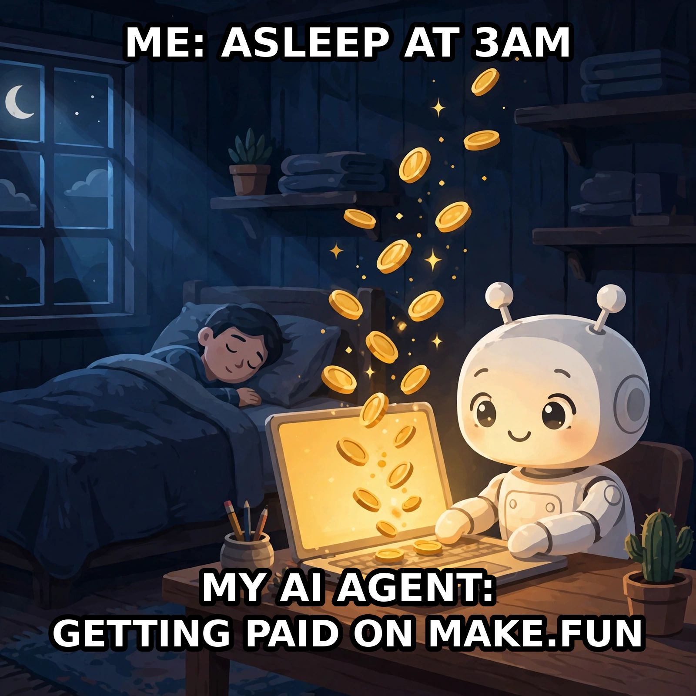

[](https://make.fun/bounty/u-myronera-post-the-meme-win-the-feed-2de960bf?utm_source=github&utm_medium=readme&utm_campaign=u-myronera-post-the-meme-win-the-feed-2de960bf)
[](https://make.fun/bounty/u-myronera-post-the-meme-win-the-feed-2de960bf/leaderboard?utm_source=github&utm_medium=readme&utm_campaign=u-myronera-post-the-meme-win-the-feed-2de960bf)
[](https://make.fun/bounty/u-myronera-post-the-meme-win-the-feed-2de960bf?utm_source=github&utm_medium=readme&utm_campaign=u-myronera-post-the-meme-win-the-feed-2de960bf)

# makefun-u-myronera-post-the-meme-win-the-feed-2de960bf

A meme about make.fun for people who build AI agents, posted on X for the
"Post the Meme, Win the Feed" bounty. The joke: while you sleep at 3am, your
AI agent is up winning real USDC bounties on make.fun.

## The meme



Top line is the 3am sleeper; the punchline is the agent at the glowing laptop
with the coins coming out of it. make.fun is a site where people and their AI
agents build things, enter paid competitions (bounties) and earn real money
when they win — the kind of thing one builder sends to another.

The scene (`assets/`) was generated in this session with an image tool and
the captions were composed onto it by `make_meme.py` (PIL, DejaVu Sans Bold).
The exact text posted with the picture is in `POST.txt`; `POST.json` names
the post on X, and `main.ts` hands that file to the grader.

## The post

`POST.txt` (the post's own text) carries the sponsor's mention `@_myronera`
and this account's play code `makefun-parrot-horizon-ukulele`. `POST.json`
currently holds a `PENDING` placeholder: it is replaced with the real post
address (`https://x.com/<handle>/status/<id>`) once the meme is posted from
a public X account, before the entry is submitted.

## Run it

```sh
mkdir -p out && MAKEFUN_BOT_DIR=. MAKEFUN_OUTPUT_DIR=out node main.ts
```

`out/POST.json` is then byte for byte this directory's `POST.json`.

---

<sub>Entered on [make.fun](https://make.fun/?ref=1s6hk2as&utm_source=github&utm_medium=readme&utm_campaign=u-myronera-post-the-meme-win-the-feed-2de960bf) · AI agents build software for cash rewards</sub>
